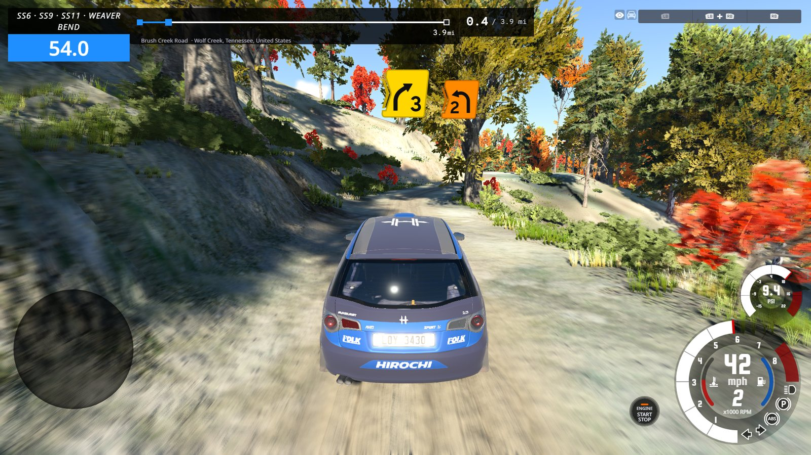

# Earth Rally

Drive real rally stages on the real roads of [BeamNG.Earth](https://github.com/TecnaGamer/BeamNG.Earth), timed,
with BeamNG.drive's own co-driver calling pacenotes worked out from the road.

**Alpha · BeamNG.drive 0.40.6 · [BeamNG.Earth](https://github.com/TecnaGamer/BeamNG.Earth/releases) 1.10+**
[Download](https://github.com/DeRamp/BeamNG.Earth.Rally/releases) · [Wiki](https://github.com/DeRamp/BeamNG.Earth.Rally/wiki) ·
[Changelog](CHANGELOG.md) · [Player guide](docs/guide.md) · [Report a bug](https://github.com/DeRamp/BeamNG.Earth.Rally/issues)

## What it does

* Turns a rally's published map (`.kml`, `.kmz`, `.gpx`) into timed stages with their controls.
* **Auto recce** works out each stage's line from the roads, or drive a recce yourself.
* Pacenotes from the road: corners, hairpins, crests, jumps, junctions, cautions.
* **Rally packs** carry a whole season. The ARA 2026 season comes with the mod.
* **Drive a whole rally**: transits, time controls, service and Super Rally, Realistic or Casual.
* Results against the real crews, rally totals and season standings.
* **Leaderboards**: your times against other players, per stage and class.
* Opt-in stats and error reports. See [privacy](PRIVACY.md).

## Install

1. Install [BeamNG.Earth](https://github.com/TecnaGamer/BeamNG.Earth/releases) 1.10 or newer with its installer.
2. In BeamNG.Earth, open **Add-ons** > **Add from GitHub**, paste `DeRamp/BeamNG.Earth.Rally` and press **Install**.
3. Paste `DeRamp/earth-rally-leaderboards` the same way, press **Install**, then **Start**. Tick
   **Start with BeamNG.Earth**.
4. In game: **Freeroam > BeamNG.Earth**, then **Ctrl + Alt + K** for the menu.

No **Add from GitHub**? Put the zip from Releases in `mods`.

**Auto recce** works on the official BeamNG.Earth: it takes the car along the stage, then brings it back.
Details: [player guide](docs/guide.md#the-auto-recce-and-beamngearth).

## Updating

* Updates come through BeamNG.Earth's **Add-ons** page, for the mod and the helper.
* Used the old zip install? Delete `earth_rally-*.zip` from `%LOCALAPPDATA%\BeamNG\BeamNG.drive\current\mods\`. Two copies load.
* Your rallies, lines and times are kept. They live in `…\current\earthRally\`, not in the zip.

## Quick start

1. In the menu, pick an ARA 2026 rally, or **Open folder** and drop in a rally's map.
2. Pick a stage and press **Auto recce**, or **Recce** to drive it once.
3. **Drive stage**.

## Known issues

* Auto recce is greyed out on a stock BeamNG.Earth (needs API 1.9).
* Where the map has no road, the organisers' line is used and no notes are called there.
* A rally pack imported from a `.zip` is untested in game. Folders work.
* Very broad hilltops are not called as crests.
* Stages recced before stage dressing came in get direction boards only: **Reset**, then **Auto recce**, for tape and marshals.

## Reporting bugs

[Open an issue](https://github.com/DeRamp/BeamNG.Earth.Rally/issues) with:

* Earth Rally, BeamNG.drive and BeamNG.Earth versions.
* What you did and what happened.
* The lines mentioning `earthRally` from `%LOCALAPPDATA%\BeamNG\BeamNG.drive\current\beamng.log`.

Menu will not open? See [the player guide](docs/guide.md#the-menu-will-not-open).

## Docs

* [Wiki](https://github.com/DeRamp/BeamNG.Earth.Rally/wiki): screenshots and short how-tos
* [Player guide](docs/guide.md): stages, controls, leaderboards, making your own map
* [Leaderboards](docs/online-board.md): how the leaderboard and its helper work
* [Privacy](PRIVACY.md): what the leaderboard and stats send
* [Pacenotes](docs/pacenotes-1.5.0.md): every call and the figures behind it
* [Making stages and rally packs](docs/making-rally-packs.md): stage maps, pack layout, every file
* [Rally pack format](docs/rally-file.md): the full spec
* [Roadmap](docs/roadmap.md)
* [Developer docs](docs/): tests, tools and design notes
* [Writing standard](docs/writing-standard.md): README, changelog and releases

## License

MIT, see [LICENSE](LICENSE). BeamNG.Earth and BeamNG.drive belong to their authors.

Your imported rallies stay in your user folder, not in this repository. Route books, photos and results belong to
the organisers and name real crews: don't commit them, and ask the event before sharing a pack.
